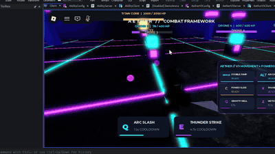
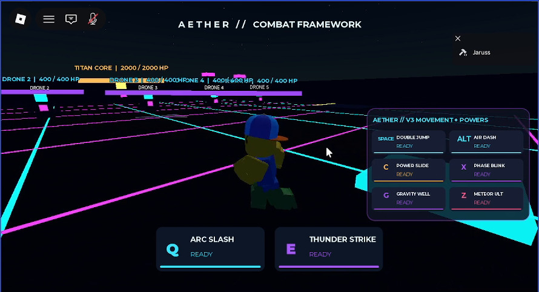
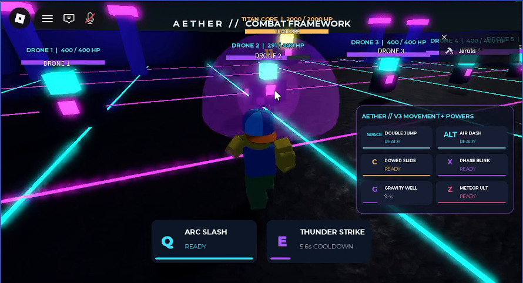
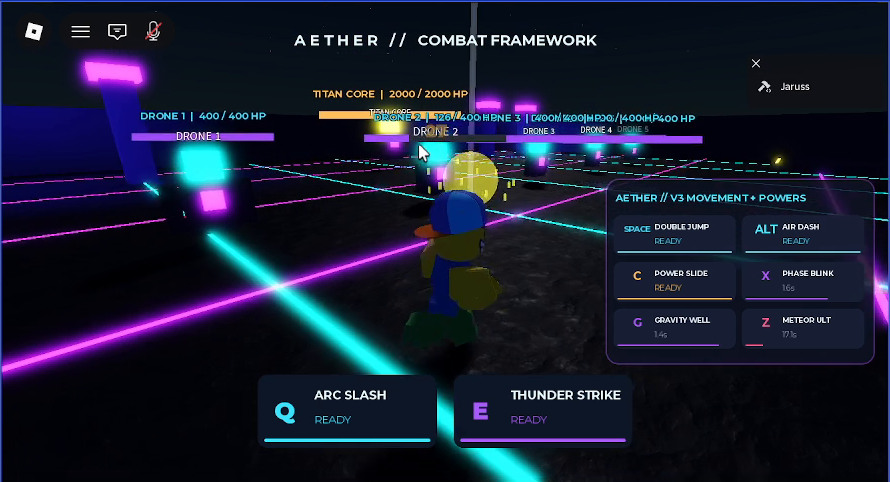
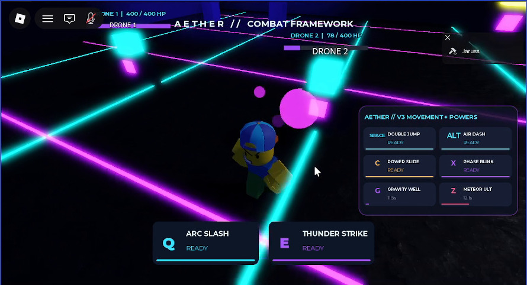

# AETHER — Combat & Movement Framework

**Roblox Studio · Luau · Combat abilities · Advanced movement · Personal technical prototype**

> An ability-focused Roblox combat and traversal prototype, combining server-controlled gameplay logic, custom scripted effects, and a training arena. **Work in progress** — not a completed or commercially shipped game.

### Gameplay showcase

**[▶ Watch the complete 48-second gameplay recording (MP4)](assets/video/AETHER-Combat-Playthrough-Web.mp4)** · [Direct playable video link](https://raw.githubusercontent.com/GregDoucette1337/AETHER-Combat-Framework/main/assets/video/AETHER-Combat-Playthrough-Web.mp4)

*Actual Roblox Studio footage, cropped to the gameplay viewport. The linked version is compressed for convenient viewing.*



### Screenshots from the playthrough

| Neon training arena & HUD | Energy abilities |
| :---: | :---: |
|  |  |
| **Impact sequence** | **Close-range effects** |
|  |  |

[See another training-target screenshot](assets/screenshots/05_training_targets.jpg).

## Systems showcased

| Feature | Gameplay |
| --- | --- |
| **Arc Slash** | Directional close-range energy attack |
| **Thunder Strike** | Targeted lightning attack with impact warning |
| **Double Jump** | An additional airborne jump |
| **Air Dash** | Directional midair movement burst |
| **Power Slide** | Quick low-to-the-ground traversal |
| **Phase Blink** | Short-range teleport with obstruction checks |
| **Gravity Well** | Timed area attack with repeated damage pulses |
| **Meteor Barrage** | Multi-impact ultimate, followed by a stronger final strike |
| **Practice targets** | Training dummies for testing abilities and damage |

### Technical highlights

- **Luau** scripts using Roblox client/server architecture
- Configurable damage, ranges, cooldowns, and movement characteristics in `ModuleScript` files
- Server-side validation of ability requests and damage application
- `RemoteEvents` separating player inputs and visible ability effects
- Client-side HUD and procedural VFX
- Optional arena generators and practice targets

**Note:** Source inspection confirms these systems are implemented in the scripts. Full visual polish, game balance, multiplayer behavior, and platform compatibility should be validated in Roblox Studio before describing them as production-ready.

## Repository layout

```text
ReplicatedStorage/
  AbilityConfig.luau
  AetherV3Config.luau
ServerScriptService/
  AbilityServer.luau
  DemoArena.luau
  AetherV3Server.luau
  AetherV3Arena.luau
StarterPlayer/StarterPlayerScripts/
  AbilityClient.luau
  AetherV3Client.luau
```

The V3 package extends the original ability framework. **Use only one arena generator at a time:** `DemoArena` OR `AetherV3Arena`.

## Run locally

1. Open Roblox Studio and create a **Baseplate**, or make a **backup** of your existing AETHER place.
2. In Explorer, create matching `ModuleScript`, `Script`, and `LocalScript` objects in the locations shown above.
3. Copy each `.luau` file's contents into its respective Studio script.
4. Disable one of the two arena generators before testing.
5. Press **Play (F5)**. Use **Output** to inspect errors, and test all abilities against training targets.
6. Use **Test → Server & Clients** to evaluate replicated effects and player interactions.

For more detailed installation and demo guidance, see [SETUP.md](docs/SETUP.md).

## Status and attribution

AETHER is a **personal learning and technical showcase project**, developed through scripting and user-led iteration in Roblox Studio. It is **not previous client work**, and the files are provided as a demonstrative prototype. The source was extracted from the uploaded `.rbxl` place and organized for GitHub. A gameplay recording captured from Roblox Studio is linked above, alongside screenshots extracted from that recording.

## Commissions and collaboration

Interested in a Roblox gameplay system or prototype? Send a short brief with the intended feature, references, timeline, and approximate budget. Contact details will be added to the public portfolio.

*Roblox is a platform of Roblox Corporation; this is an independent project.*
